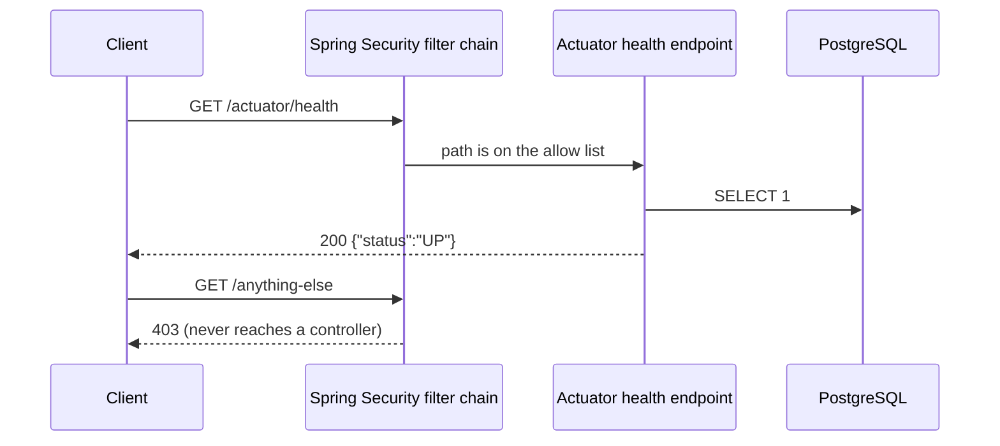
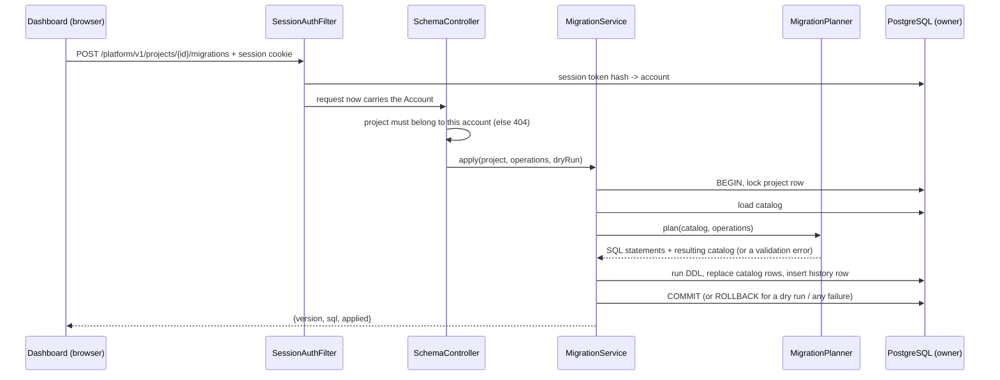
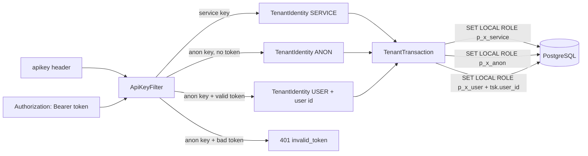
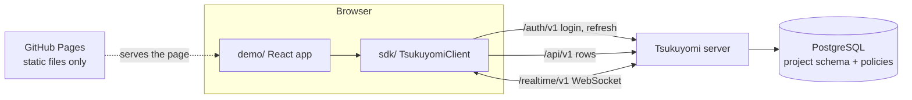

# Architecture

How a request travels through the system. This file grows with each milestone; a section is only
written once the code for it exists, so everything here can be checked against the source.

For the intended end state, see the diagram in `PLAN.md` section 1.

## Health check and deny-by-default



At startup, Flyway connects as the owner role and applies new files from
`backend/src/main/resources/db/migration` to schema `tsk_platform`.

## Two database identities

| Pool | Logs in as | Can do | Used by |
|---|---|---|---|
| owner (Spring's default `DataSource`) | the database owner | everything: platform tables, DDL | control plane |
| tenant-data (private to `TenantTransaction`) | `tsk_api` | nothing, until it switches into one project's role | data plane |

## Control plane: designing a table



## Data plane: a REST call

```mermaid
sequenceDiagram
    participant C as Client app
    participant K as ApiKeyFilter
    participant DC as DataController
    participant RE as RowEndpoints
    participant RS as RowService
    participant QP as QueryParser
    participant QV as QueryValidator
    participant SB as SqlBuilder
    participant TT as TenantTransaction
    participant P as PostgreSQL (tsk_api)

    C->>K: GET /api/v1/posts?select=title,authors(name)&priority=gte.2 + apikey header
    K->>P: key hash -> project + role (owner pool)
    K->>DC: request now carries a TenantIdentity
    DC->>RE: select(identity, "posts", request)
    RE->>RS: select(identity, "posts", query parameters, count?)
    RS->>QP: parse(parameters)
    QP-->>RS: RawQuery (plain text in a structure, nothing checked yet)
    RS->>QV: select("posts", RawQuery)
    QV->>QV: look every table and column name up in the catalog (404 / 400 if absent)
    QV-->>RS: SelectQuery (holds catalog objects; request values wrapped in Param)
    RS->>SB: select(project, limits, SelectQuery)
    SB-->>RS: CompiledSql (SQL text with ? placeholders + bind list)
    RS->>TT: execute(identity, work)
    TT->>P: BEGIN
    TT->>P: SET LOCAL ROLE p_x_service, search_path, statement_timeout, tsk.user_id
    TT->>P: the compiled statement, with bind parameters
    Note over P: table grants + row-level security decide what is visible
    TT->>P: COMMIT (role and settings vanish)
    TT-->>C: JSON text straight from Postgres
```

The dashboard's data browser takes the same path from `RowService` onwards, as the service role.

### The three compiler stages

| Stage | Input -> output | Responsible for | Must never |
|---|---|---|---|
| `QueryParser` | query string -> `RawQuery` (text in a structure) | The shape of the request: `select` grammar, `column=op.value` filters, `order`, `limit`, `offset`. Size limits. | Know which tables or columns exist, or trust any text it reads. |
| `QueryValidator` | `RawQuery` -> `SelectQuery` / `WriteCommand` (trusted AST) | The trust boundary. Looks each name up in the catalog and keeps the catalog's object. Checks operators against column types, relations, and `QueryLimits`. | Let a request string into the AST as a name. Request text survives only as a `Param` value. |
| `SqlBuilder` | AST -> `CompiledSql` (SQL + bind list) | Writing SQL: keywords are literals in the class, identifiers are quoted catalog names, every value becomes `?`. | Accept a `String` from a caller, or put a `Param` value into the SQL text. |

Worked example. The request below uses the test blog schema, where `posts` has two columns that
reference `authors`, so the column is named with `!`:

```
GET /api/v1/posts?select=title,authors!author_id(name)&priority=gte.2&order=title&limit=5
```

`SqlBuilder` compiles it to this statement for project schema `p_0123456789ab` (line breaks added
here for reading; the real text is one line):

```sql
select coalesce(json_agg(row_to_json(r)), '[]'::json)::text from (
  select t0."title",
    (select row_to_json(e1) from (
      select t1."name" from "p_0123456789ab"."authors" as t1
      where t1."id" = t0."author_id") e1) as "authors"
  from "p_0123456789ab"."posts" as t0
  where t0."priority" >= cast(? as integer)
  order by t0."title", t0."id"
  limit ? offset ?) r
```

Bind parameters, in the order of the `?` placeholders: `"2"`, `5`, `0`. The first is the filter
value. It comes from the request, is sent as the text `"2"` and is cast by Postgres to `integer`.
The other two are `limit` and `offset` as integers; `offset` defaulted to 0.

Things to notice: the table aliases are `t0` (posts) and `t1` (authors), and `e1` names the inner
row; `id` is appended to `order by` so the order is total; the author comes back as a nested JSON
object because Postgres builds it in the sub-select.

## Who is asking: from headers to a Postgres role



Inside Postgres, every table has row-level security forced on. A rule set in the dashboard is a
policy such as `USING (owner_id = tsk.uid())` for the `p_x_user` role; `tsk.uid()` reads the
transaction-local `tsk.user_id`. The API code never adds an ownership filter itself.

Login (`POST /auth/v1/login`): `ApiKeyFilter` identifies the project, `AuthService` checks the
BCrypt hash in `tsk_platform.end_user`, then issues a JWT signed with the project's secret
(`JwtCodec`) and a single-use refresh token stored as a hash.

## Live updates: from a write to a subscriber's screen

```mermaid
sequenceDiagram
    participant W as Writer (any API request)
    participant PG as PostgreSQL
    participant L as ChangeListener (LISTEN)
    participant H as LiveHub (one thread)
    participant C as Subscriber (WebSocket)

    C->>H: auth {apikey, token} then subscribe {table}
    H->>L: start (first subscriber only)
    L->>PG: LISTEN tsk_changes
    H-->>C: subscribed {cursor}

    W->>PG: INSERT INTO notes ...
    Note over PG: trigger tsk.record_change():<br/>insert into change_event,<br/>pg_notify(table, op, row id)
    W->>PG: COMMIT
    PG-->>L: notification (only after commit)
    L->>H: queue the change
    loop each distinct identity subscribed to notes
        H->>PG: SET LOCAL ROLE ...; SELECT the row by id
        PG-->>H: the row, or nothing (row-level security)
    end
    H-->>C: event {op, id, row, eventId, cursor} (only if the row was visible)
```

The pieces, in the order a change passes through them:

| Piece | File | Job |
|---|---|---|
| Trigger | `V4__change_events.sql`, `schema/ChangeTrigger.java` | Record "row X of table T changed" and notify |
| Listener | `live/ChangeListener.java` | One connection that only listens; reconnects if it breaks |
| Hub | `live/LiveHub.java` | Who is subscribed; reads the row as each identity; sends |
| Log | `live/EventLog.java` | Replay for reconnecting clients; trimmed after 10 minutes |
| Endpoint | `live/LiveSocketHandler.java` | The JSON protocol on `/realtime/v1`, limits |

Deletes: the row is gone, so it cannot be read. The trigger keeps a copy in the log and the hub
applies the table's read rule to that copy; only the id is sent (DECISIONS.md D32).

Reconnecting: the client sends `subscribe {table, since: <last cursor>}`. The hub reads the missed
events from `change_event`, checks each against the client's identity exactly as above, and sends
them before any new live event. If it cannot know what was missed it answers `resync: true` and
the client loads the table again (DECISIONS.md D33, D34).

## The demo app: where each piece runs



The demo has no server of its own. Its whole backend is two tables and their rules
(`scripts/demo-project.mjs`); the page ships the project's anon key, and the database decides what
that key and each logged-in user may do. `sdk/src/query.ts` builds the URLs described in the
README, `sdk/src/auth.ts` keeps the login fresh, and `sdk/src/live.ts` is the client half of the
live-update flow above (reconnect, cursor, repeated events).
