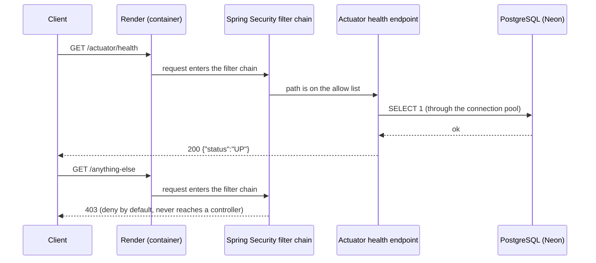

# Architecture

How a request travels through the system. This file grows with each milestone; a section is only
written once the code for it exists, so everything here can be checked against the source.

For the intended end state, see the diagram in `PLAN.md` section 1.

## What exists today (M0)

At startup, Flyway connects as the owner role, creates schema `tsk_platform` if needed, and applies
any new files from `backend/src/main/resources/db/migration`.

## Coming next

- M1: control-plane request (dashboard → create table → DDL in one transaction).
- M2/M3: data API request (API key → identity → query compiler → tenant transaction → RLS).
- M4: live-update subscription (trigger → outbox → NOTIFY → listener → WebSocket).
