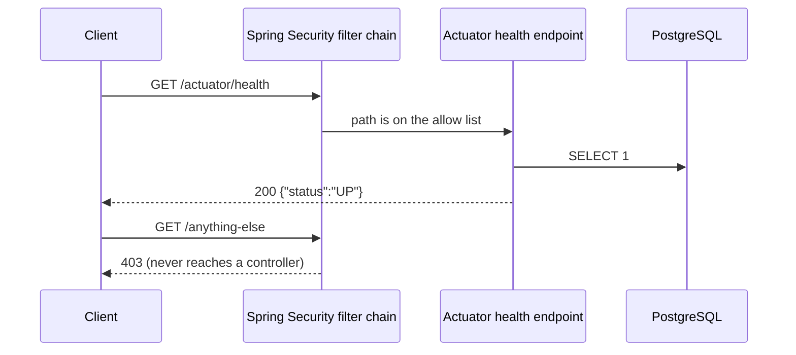
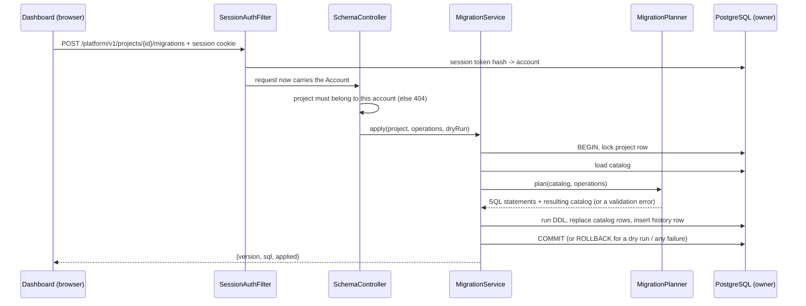
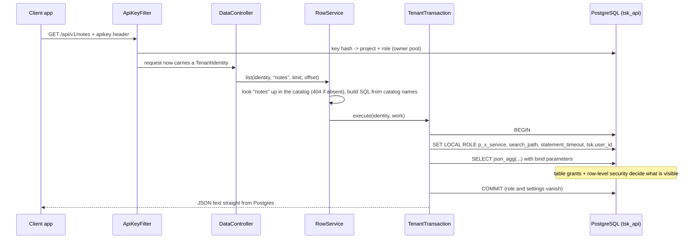

# Architecture

How a request travels through the system. This file grows with each milestone; a section is only
written once the code for it exists, so everything here can be checked against the source.

For the intended end state, see the diagram in `PLAN.md` section 1.

## Health check and deny-by-default

At startup, Flyway connects as the owner role and applies new files from
`backend/src/main/resources/db/migration` to schema `tsk_platform`.

## Two database identities

| Pool | Logs in as | Can do | Used by |
|---|---|---|---|
| owner (Spring's default `DataSource`) | the database owner | everything: platform tables, DDL | control plane |
| tenant-data (private to `TenantTransaction`) | `tsk_api` | nothing, until it switches into one project's role | data plane |

## Control plane: designing a table

## Data plane: a REST call

The dashboard's data browser takes the same path from `RowService` onwards, as the service role.

## Coming next

- M2: the query compiler replaces the simple SQL building in `RowService`.
- M3: end-user tokens add a `USER` identity; rules become row-level security policies.
- M4: live-update subscription (trigger → outbox → NOTIFY → listener → WebSocket).
