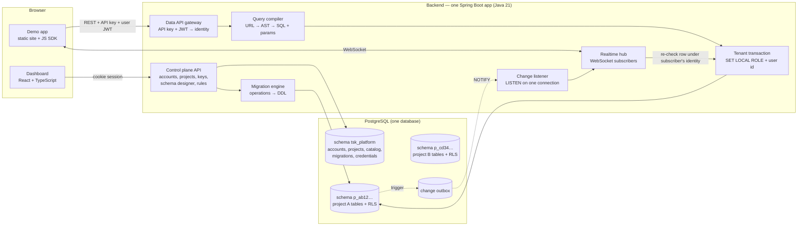
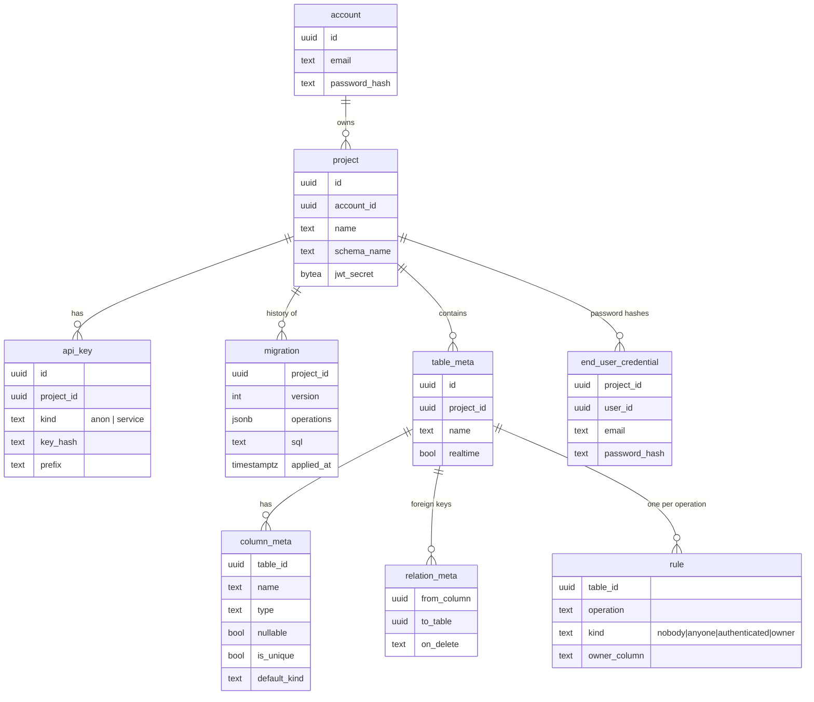

# Tsukuyomi — build plan

A backend-as-a-service: design tables in a GUI, get a secured REST API, end-user auth,
row-level permissions and live updates, with no backend code.

Status: **waiting for approval.** Nothing below is built yet.

---

## 1. What we are building, in one picture



Two halves, and the split matters:

- **Control plane**: what the project owner uses (dashboard). Runs DDL. Connects to Postgres as the owner role.
- **Data plane**: what apps built on a project use (REST + WebSocket). Connects as a login role that has
  **no privileges of its own**. It can only do anything by switching into one project's role for one transaction.

---

## 2. Stack, with the reason for each choice

Full reasoning and alternatives go in `DECISIONS.md` as each one is implemented. Short version:

| Piece | Choice | Why |
|---|---|---|
| Backend | Java 21, Spring Boot 4.1 (Web MVC, Security), Maven wrapper | Your track. MVC (blocking) is easier to read and debug than WebFlux; virtual threads give enough concurrency. |
| DB access | `JdbcTemplate` + hand-written SQL builder. **No JPA/Hibernate** | Tables are created at runtime by users; an ORM needs classes known at compile time. Also the SQL builder is the part you must be able to explain. |
| Database | PostgreSQL 17 | Row-level security, transactional DDL, schemas, roles, LISTEN/NOTIFY: every hard feature leans on something Postgres already does well. |
| Platform migrations | Flyway | Standard tool for our own tables. Tenant tables use our own engine (section 5). |
| Dashboard | React + TypeScript + Vite, TanStack Query, plain CSS | Most common frontend stack in placements. Built into the Spring Boot jar, so one deploy and one URL. |
| SDK | ~200 lines of TypeScript (`tsukuyomi-js`) | The demo app talks only through this, which proves "zero backend code". |
| Tests | JUnit 5, Testcontainers (real Postgres), jqwik (property-based fuzzing) | Injection and permission tests are only meaningful against a real database. |
| Local containers | Colima + Docker CLI | Free; same image locally and in production. |
| Hosting | Render free web service (backend + dashboard), Neon free Postgres, GitHub Pages (demo app) | No card. See risks in section 9. |
| CI | GitHub Actions | Free for public repos; runs the attack tests on every push. |

Repository layout:

```
backend/     Spring Boot app, packaged by feature:
             platform/  tenancy/  schema/  query/  auth/  rules/  realtime/  common/
dashboard/   React app (built into backend/src/main/resources/static)
sdk/         tsukuyomi-js
demo/        demo app (static)
bench/       load-test scripts and raw results
PLAN.md  DECISIONS.md  LEARNING.md  ARCHITECTURE.md  README.md
```

---

## 3. Data model (control plane, schema `tsk_platform`)



Per project, in its own schema `p_<12 hex chars>`:

- a built-in `users` table (`id`, `email`, `created_at`): the public profile of each end user, so user
  tables can have a foreign key to it. Password hashes are **not** here; they stay in `tsk_platform`,
  which no project role can read.
- the tables the owner designs. Every table gets an `id uuid` primary key and `created_at`.

`table_meta` / `column_meta` / `relation_meta` are **the catalog**. The query compiler never trusts a name
from a request; it looks the name up in the catalog and uses the catalog's copy.

---

## 4. Multi-tenant isolation and permissions (hard)

The requirement is "a bug in the API layer can't leak data". So enforcement lives in Postgres, in two layers.

**Layer 1: project isolation by roles and schemas.**

- `tsk_owner`: owns everything, runs DDL. Used only by the control plane.
- `tsk_api`: the data plane's login role. `NOINHERIT`, no grants. On its own it cannot read a single row.
- Per project, three `NOLOGIN` roles: `p_x_anon`, `p_x_user`, `p_x_service`. They have `USAGE` on their
  own schema only. `tsk_api` is allowed to `SET ROLE` into them.

Every data request runs inside one transaction that starts with:

```sql
SET LOCAL ROLE p_x_user;                         -- chosen from the API key + JWT
SELECT set_config('tsk.user_id', $1, true);      -- true = transaction-local
SET LOCAL search_path = p_x;
SET LOCAL statement_timeout = '3s';
```

`SET LOCAL` disappears at commit/rollback, so a pooled connection can never carry one request's identity
into the next. This lives in exactly one class (`TenantTransaction`); no other code can get a data connection.

**Layer 2: row rules as Postgres row-level security (RLS).**

In the GUI the owner picks, per table and per operation (read / insert / update / delete), one of:
`nobody` · `anyone` · `authenticated` · `owner` (a chosen column equals the current user).

Each choice compiles to a `CREATE POLICY`. Example for "owner can read":

```sql
CREATE POLICY read_owner ON p_x.notes FOR SELECT TO p_x_user
  USING (owner_id = tsk_platform.uid());
```

RLS is `ENABLE`d and `FORCE`d on every table, so the default with no rules is **deny everything**.
Rules are structured data, never raw SQL, so there is no injection path through a rule.
The `service` key maps to `p_x_service`, which gets an allow-all policy (for server-side use only).

**What a bug can still do, honestly:** if the gateway resolved the wrong project from an API key, it would
enter the wrong project's role. That mapping is one small, heavily tested function. Any bug *after* that
point (in the query compiler, filters, expansion, realtime) is contained by Postgres.

**Tests:** user A reads/updates/deletes user B's rows; anon writes; project A's key against project B's
tables; forged and expired JWTs; JWT from project A used on project B; a deliberately broken compiler
(test-only) that omits every WHERE clause, to prove RLS still holds.

---

## 5. Schema designer and migrations (medium)

The GUI never sends SQL. It sends a list of **operations**:

`CreateTable`, `DropTable`, `RenameTable`, `AddColumn`, `DropColumn`, `RenameColumn`, `SetNullable`,
`AddUnique`, `DropUnique`, `AddForeignKey`, `DropForeignKey`, `SetRule`, `SetRealtime`.

The backend:

1. validates each operation against the current catalog (names match `^[a-z][a-z0-9_]{0,62}$`, are not
   reserved, types come from a fixed list: `text, integer, bigint, numeric, boolean, timestamptz, date, uuid, jsonb`);
2. generates DDL from them;
3. runs DDL + catalog update + a new `migration` row **in one transaction**. Postgres DDL is transactional,
   so a failed migration leaves nothing half-applied;
4. bumps the project's catalog version so cached metadata is reloaded.

The dashboard shows the migration history with the generated SQL for each version, which is also a nice
way for you to learn DDL.

---

## 6. Query compiler (hardest, most interview-relevant)

URL syntax (deliberately close to PostgREST so there are docs to compare against):

```
GET /api/v1/notes?select=id,title,author(email),comments(id,body)
                 &status=eq.open&priority=gte.3&title=ilike.*report*
                 &order=created_at.desc&limit=20&offset=40
```

Pipeline, each stage a separate package with its own tests:

```
raw query string
  → Parser      → untyped AST (strings only, nothing trusted)
  → Validator   → typed AST: every table/column resolved to a catalog object,
                  every value converted to the column's Java type, limits enforced
  → SqlBuilder  → SQL text built only from catalog identifiers (quoted) and "?" placeholders
                  + a list of bind parameters
  → TenantTransaction executes it
```

**Why it is injection-safe by design, not by care:** `SqlBuilder` has no method that accepts a `String`
from the request. It accepts `ColumnRef`, `TableRef` and `Param` objects, and the only way to get a
`ColumnRef` is a catalog lookup. Values only ever travel as bind parameters. A unit test scans the
builder's API to enforce this.

Details:

- Operators: `eq, neq, gt, gte, lt, lte, like, ilike, in, is` (null/true/false).
- Expansion follows foreign keys, to-one and to-many, compiled to `LATERAL` subqueries with `json_agg`.
  Max depth 2, and each nested list is capped. RLS applies to expanded tables automatically.
- Pagination: `limit` (max 100) + `offset`, total count on request via a header.
- Writes: `POST` (insert, single or batch), `PATCH` and `DELETE` (require at least one filter), same compiler.

**Tests:** parser unit tests; a corpus of classic injection payloads in every position (column name,
operator, value, order, select, expansion); jqwik fuzzing with random strings asserting that the output
SQL contains only catalog identifiers and that a canary table is never touched; integration tests against
real Postgres.

---

## 7. Live updates (hard)

```
write commits → row trigger inserts into outbox + NOTIFY(event id)
             → one listener connection receives the id, loads the event
             → for each group of subscribers with the same identity:
                   re-read the row inside TenantTransaction as that identity
                   visible → push over WebSocket;  not visible → drop
```

Decisions and their reasons:

- **Triggers + LISTEN/NOTIFY, not WAL logical replication.** WAL decoding is what Supabase does and
  scales better, but it needs replication slots and far more code. Triggers work on any Postgres and
  fit in 4 days. `DECISIONS.md` will cover this comparison in depth; expect the question in interviews.
- **NOTIFY carries only an event id**, because payloads are limited to 8 KB.
- **Permissions on events:** the row is re-read under each subscriber's identity, so RLS decides who sees
  what. No second copy of the rules in Java. Delete events carry only the primary key (the row is gone,
  so it cannot be re-checked); this is the same trade-off Supabase makes.
- **Missed events:** the client sends the last event id on reconnect and the server replays from the
  outbox (kept ~10 minutes). The subtle bug here is that ids can commit out of order; the plan is to
  fetch by notified id on the live path and use a snapshot-safe read for catch-up. This gets its own test.
- **Free-tier reality:** Neon suspends an idle database, which drops the listener. The listener
  reconnects and catches up from the outbox.
- **Protocol:** plain WebSocket with small JSON messages (`auth`, `subscribe`, `unsubscribe`, `event`,
  `error`), not STOMP, so you can read every byte of it.
- **Limit:** subscriber state is in memory, so this is single-instance. Stated openly in the README.

---

## 8. Auth

- **Dashboard accounts:** email + password (BCrypt), session as an httpOnly SameSite cookie. Open signup
  with a config switch to close it.
- **End users of a project:** `POST /auth/v1/signup`, `/login`, `/refresh` → short-lived JWT (HS256)
  signed with **that project's** secret, so a token from one project is meaningless in another.
- **API keys:** two per project. `anon` (safe to ship in a browser; everything it does is subject to
  rules) and `service` (secret; bypasses rules). Random 32 bytes, stored as SHA-256, shown once.
- **Quotas per account** (all configurable): 3 projects, 15 tables per project, 5,000 rows per table,
  60 requests/minute per key, 20 WebSocket connections per project, 100 KB request body.
- No email verification or password reset in v1 (needs an email provider). Listed under "Next".

---

## 9. Milestones, in build order

Rule: **every milestone ends deployed and working**, with docs updated. If credits stop after any
milestone, what exists is complete at that size.

| # | Milestone | Ends when | Difficulty | Day |
|---|---|---|---|---|
| M0 | Skeleton + deploy pipeline | Health endpoint live on Render, connected to Neon; CI green; **spike proves Neon allows our role/RLS/NOTIFY design** | routine + 1 risk | 1 |
| M1 | Thin end-to-end slice | Sign up → create project → create a table in the GUI → insert/list rows through the REST API with the service key → see rows in the dashboard | medium | 1 |
| M2 | Query compiler | Filters, sort, pagination, select, expansion; injection suite + fuzzing green | **hard** | 2 |
| M3 | End-user auth + rules | Signup/login, anon key, rules → RLS, attack suite green | **hard** | 2 |
| M4 | Live updates | SDK subscription receives permitted changes only; reconnect replay works | **hard** | 3 |
| M5 | Full schema designer | All operations in section 5, relations, constraints, migration history view | medium, mostly routine UI | 3 |
| M6 | SDK + demo app | Task board with login, private and shared lists, live updates, deployed, zero backend code | routine | 4 |
| M7 | Hardening + numbers | Quotas, rate limits, benchmarks, README with GIF, all four docs final | medium | 4 |

Cut order if time runs short: ER-diagram view (M5 extra) → batch inserts → total-count header →
to-many expansion → M5 alter operations beyond add/drop column.

Each milestone also updates:
`DECISIONS.md` (choices made in it), `ARCHITECTURE.md` (flows it added), `LEARNING.md` (a new study
step: files, concept, one official doc link, 3–5 questions, and "rewrite this yourself" markers).

Likely "rewrite yourself" pieces: the query compiler (parser → validator → builder), `TenantTransaction`
plus the rule-to-policy generator, and the realtime listener with replay.

Commits: one logical change each, conventional messages (`feat(query): parse order parameter`),
pushed at least at every milestone.

---

## 10. Routine work, specified so a cheaper model can do it

**Control-plane endpoints** (`/platform/v1`, JSON, cookie session):

| Method + path | Does |
|---|---|
| `POST /accounts`, `POST /session`, `DELETE /session`, `GET /me` | signup, login, logout, current account |
| `GET/POST /projects`, `GET/DELETE /projects/{id}` | list/create/read/delete project |
| `GET /projects/{id}/schema` | full catalog: tables, columns, relations, rules |
| `POST /projects/{id}/migrations` | body: `{operations: [...]}` → applies, returns new version + SQL |
| `GET /projects/{id}/migrations` | history |
| `GET/POST /projects/{id}/keys`, `DELETE …/keys/{keyId}` | manage API keys (secret returned once) |
| `GET /projects/{id}/tables/{t}/rows` | data browser (goes through the same query compiler, service role) |
| `GET /projects/{id}/users` | list end users |

**Dashboard screens** (React Router; each screen = one file in `dashboard/src/pages`, data via TanStack Query hooks in `dashboard/src/api`):

1. Login / signup.
2. Project list + "new project".
3. Project home: API URL, keys (copy / regenerate), quick-start snippet.
4. Table list + table editor: a form of rows, one per column (name, type, nullable, unique, default,
   foreign key target). "Save" computes the diff against the loaded schema as a list of operations,
   shows the SQL preview returned by a dry run, then applies.
5. Rules editor: a 4×4 grid per table (operation × rule kind), owner-column dropdown.
6. Data browser: paginated grid, add/edit/delete row.
7. Migration history: version, time, operations, SQL.
8. End users list.
9. (M5 extra) read-only ER diagram.

Conventions for all routine code: controller → service → repository; DTOs are Java records; validation
with Bean Validation; errors as `{"error": {"code", "message"}}`; no logic in controllers; every
endpoint has one happy-path and one unauthorized test.

---

## 11. Risks and what I need from you

| Risk | Handling |
|---|---|
| Neon may restrict `CREATE ROLE` / `SET ROLE` in ways that break section 4 | Tested in M0 before anything depends on it. Fallback: another no-card Postgres (Aiven or Supabase's free database), same design. |
| Render free tier: 512 MB RAM, 0.1 CPU, sleeps after 15 idle minutes (~1 min wake) | JVM tuned for small heap; demo app shows a "waking the server" state; README says so. Benchmarks are run locally and labelled as such, plus one honest latency figure from the live URL. |
| Render may ask for a card at signup (I could not confirm either way) | If it does, I stop and tell you before going further. |
| Neon free: 1 GB storage, compute hours capped monthly, auto-suspend after 5 idle minutes | Quotas in section 8 keep usage far below this; listener reconnect handles suspend. |
| Credits run out early | Milestone rule in section 9. |

From you, during M0 (about 10 minutes):

1. Create a free Neon account and a Render account (sign in with GitHub on both). I cannot create accounts for you.
2. Put the Neon connection string in a local `.env` file that I will tell you the path of (it is git-ignored and never committed).
3. Approve the public repository name: **`tsukuyomi`** under your GitHub account.

I will install Colima and the Docker CLI with Homebrew at the start of M0.

---

## 12. Out of v1 (goes in README under "Next")

File storage, webhooks, billing, teams/collaborators, visual polish, email verification and password
reset, OAuth logins, custom SQL rule expressions, WAL-based realtime, multi-instance realtime, database
backups per project.
