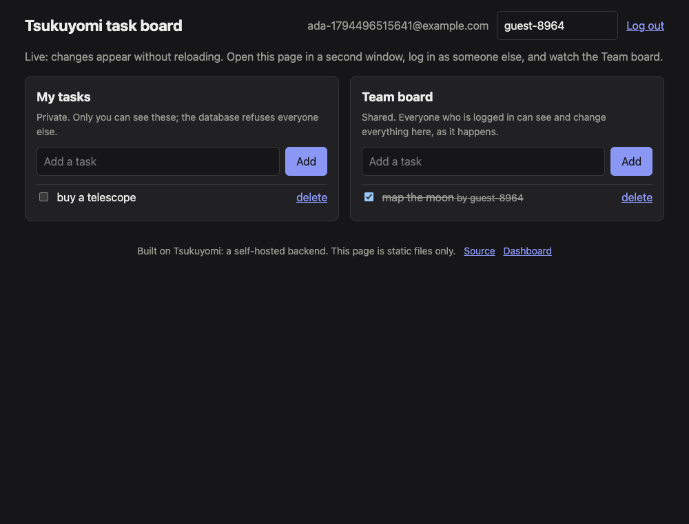
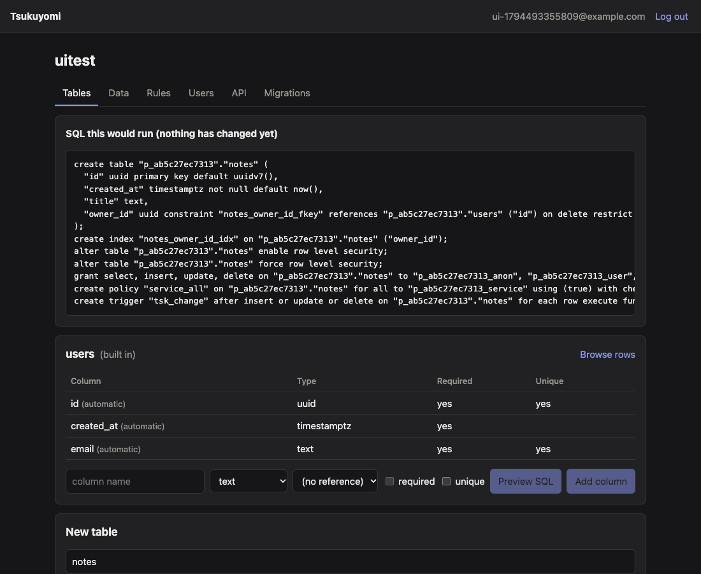
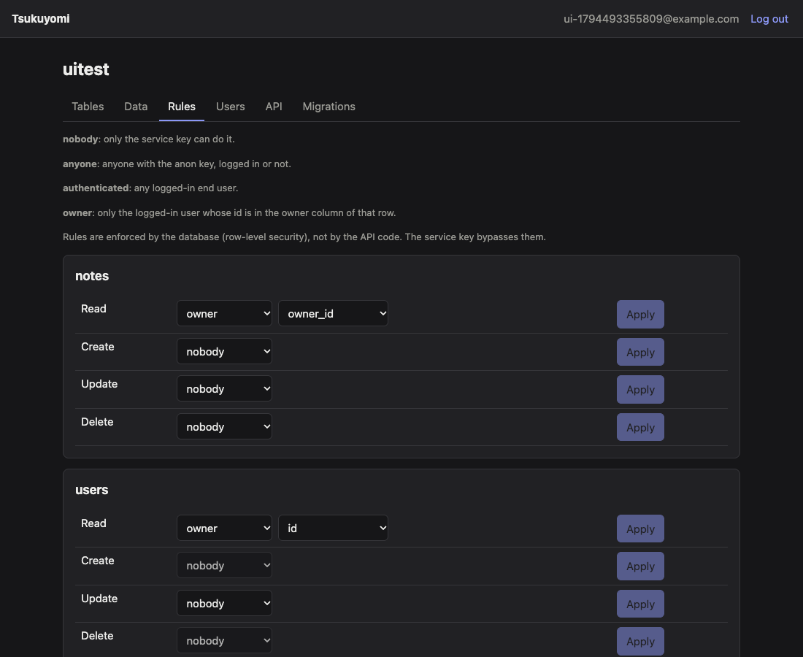

# Tsukuyomi

**Design your tables in a browser and get a secured REST API, user auth, row-level permissions and
live updates, without writing backend code.** A small, self-hostable backend-as-a-service.

**Live:** https://tsukuyomi-l9kg.onrender.com (free hosting: the first request after 15 idle minutes takes about a minute to wake the server)

**Demo app:** https://silvermenace.github.io/tsukuyomi/ is a task board with login, private tasks, a
shared board and live updates. It is static files on GitHub Pages; everything else is one Tsukuyomi
project. Source in [`demo/`](demo), about 300 lines, no backend code.

| Demo app (zero backend code) | Dashboard: SQL preview before a change | Dashboard: rules |
|---|---|---|
|  |  |  |

## What it does

- **Projects.** Sign up, create a project, get an API URL and two keys. Each project lives in its
  own PostgreSQL schema with its own database roles; projects cannot see each other.
- **Schema designer.** Create and change tables, columns, relations and constraints in the
  dashboard. Every change is a versioned migration; you see the SQL before it runs.
- **Instant REST API.** Every table gets filtering, sorting, pagination and related-record
  expansion through query parameters. No request text ever becomes SQL (see "Numbers").
- **End users.** Apps built on a project have their own signup and login (`/auth/v1`).
- **Permission rules.** Per table and operation: nobody, anyone, logged-in users, or the row's
  owner. Stored as PostgreSQL row-level security policies, so a mistake in the API layer cannot
  return another user's rows.
- **Live updates.** Subscribe to a table over a WebSocket and receive the changes you are allowed
  to see, with replay after a lost connection.
- **A client SDK and a demo app** that uses nothing else.

## Numbers

Measured on 12 November 2026. What each figure does and does not show is in `DECISIONS.md` D49.

**Local** (`node scripts/bench.mjs`): Apple M4 laptop (10 cores, 16 GB) running the load
generator, the server and PostgreSQL 18 in Docker together; 16 requests in flight for 10 seconds
per test; 2,000-row table; rate limits off; 0 errors.

| Request | Requests per second | p50 | p95 | p99 |
|---|---|---|---|---|
| Read 20 rows (service key) | 1,787 | 8.6 ms | 12.6 ms | 16.2 ms |
| Read 20 rows as a user (row-level security filtering) | 1,620 | 9.4 ms | 14.9 ms | 22.0 ms |
| Filter + sort + expand a related record | 1,461 | 10.5 ms | 15.7 ms | 20.6 ms |
| Insert one row | 1,458 | 10.4 ms | 14.8 ms | 17.7 ms |
| Live update: insert sent to event received | | 4.1 ms | 5.0 ms | 6.7 ms |

**Live** (free Render instance and free Neon database, both in Singapore, measured from India,
one request at a time):

| Request | p50 | p95 |
|---|---|---|
| Health check (network only, no database) | 108 ms | |
| Read 20 rows | 116 ms | 192 ms |
| Insert one row | 114 ms | 136 ms |
| Live update: insert sent to event received | 126 ms | 349 ms |

So on the live host almost all of the time is distance; the server and database add about 10 ms.
After 15 idle minutes the free server sleeps, and the next request waits about a minute.

**Tests:** 144 backend tests against a real PostgreSQL, 10 SDK tests, run on every push.

| What is attacked | How |
|---|---|
| SQL injection | A corpus of classic payloads in every position of a request, plus 40,000 generated requests from a fixed seed; an independent check asserts that no request text appears in the SQL (`InjectionTest`) |
| Permissions | Other users' rows, forged and foreign tokens, anonymous callers, and a simulated bug in the API layer that forgets every filter (`AuthAndRulesTest`) |
| Project isolation | Keys, tokens and live subscriptions of one project used against another |
| Live updates | Who hears a change, a change that commits late, a lost server connection (`LiveUpdatesTest`) |
| Limits | Password guessing, forged addresses, encoded paths, floods, ten concurrent inserts at the row quota (`LimitsTest`) |

**Size:** about 6,200 lines of Java, 3,300 lines of tests, 1,500 lines of dashboard, 700 lines of
SDK and 300 lines of demo.

## Limits

| Limit | Value |
|---|---|
| Requests per address | 20 per second (burst 100); signup and login 10 per minute |
| Requests per API key | 50 per second (burst 200) |
| Request body | 1 MB |
| Rows per table | 10,000 |
| Tables per project, columns per table | 15, 30 |
| Projects per account, end users per project | 3, 1,000 |
| Rows per page, per query in total | 100, 25,000 |
| Query time | 3 seconds |
| Live connections | 100 per project, 20 per address |

A refused request gets `429` with code `rate_limited` and a `Retry-After` header, `413 too_large`,
or `409 quota_rows`.

## Known limits of the design

Stated plainly, with the reasoning in `DECISIONS.md`:

- **One server instance.** Live subscriptions and rate-limit counts are in memory (D35, D45).
- **Rules are per table and operation**, not per column or "owner or public" (D44).
- **If an attacker could run SQL of their choosing** on the data connection, row-level security
  would not stop them from switching roles. The query compiler is what prevents that; the two
  defences cover different halves (D27).
- **Live updates use triggers**, which add one small insert to every write (D31).
- **Signup tells you whether an email is registered**, and there is no email verification (D12).
- **On the live host a refused WebSocket ends about 20 seconds late**; the error message itself
  arrives at once and the SDK acts on that (D37).

## Run locally

Requirements: Java 21+, Node 22+, Docker.

```bash
scripts/dev-db.sh                                   # PostgreSQL in Docker on port 5433
cd backend && ./mvnw spring-boot:run -Dspring-boot.run.profiles=dev
cd dashboard && npm install && npm run dev          # in a second terminal
```

Open http://localhost:5173. The dashboard dev server forwards API calls to the backend on 8080.

Tests: `cd backend && ./mvnw verify`. They start a throwaway PostgreSQL in Docker. With Colima, first run
`export DOCKER_HOST="unix://$HOME/.colima/default/docker.sock" TESTCONTAINERS_DOCKER_SOCKET_OVERRIDE=/var/run/docker.sock`.

To run against a hosted database instead, put its `postgresql://` URL in `.env` and run
`eval "$(python3 scripts/dev-env.py)"` before starting the backend without the `dev` profile.

## REST API

Send the project's API key in a header named `apikey`. Every table you design is available at
`<host>/api/v1/<table>`. Bodies and responses are JSON.

```
apikey: <key>
```

| Method | What it does | Returns |
|---|---|---|
| `GET` | List rows, with the query parameters below | 200 and a JSON array |
| `POST` | Insert one object, or an array of objects (at most 100 rows, all with the same fields) | 201 and the new row (object body) or rows (array body) |
| `PATCH` | Change the fields in the body on matching rows. Needs at least one filter | 200 and an array of the changed rows |
| `DELETE` | Delete matching rows. Needs at least one filter | 200 and an array of the deleted rows |

`PATCH` and `DELETE` refuse to run without a filter, so a typo cannot touch every row. They accept
only filters (no `select`, `order`, `limit` or `offset`). System columns (`id`, `created_at`) cannot
be written.

### End users and permission rules

Apps built on a project use the **anon** key, which is safe to ship in a browser. What that key
may do is decided per table and per operation in the dashboard's Rules tab:

| Rule | Who is let through |
|---|---|
| nobody (default) | only the service key |
| anyone | anyone with the anon key, logged in or not |
| authenticated | any logged-in end user |
| owner | only the logged-in user whose id is in a chosen column of the row |

Rules are stored as PostgreSQL row-level security policies, so the database enforces them on every
row of every query, including expanded related records. The **service** key bypasses rules and is
for trusted server-side code only.

End users sign up and log in through `/auth/v1` (send the anon key as `apikey`):

| Endpoint | Body | Returns |
|---|---|---|
| `POST /auth/v1/signup` | `{"email", "password"}` | 201 with `access_token`, `refresh_token`, `expires_in`, `user` |
| `POST /auth/v1/login` | `{"email", "password"}` | 200, same shape |
| `POST /auth/v1/refresh` | `{"refresh_token"}` | 200, same shape; the old refresh token stops working |
| `POST /auth/v1/logout` | `{"refresh_token"}` | 204 |
| `GET /auth/v1/me` | (access token) | `{"id", "email"}` |

Send `Authorization: Bearer <access_token>` together with the anon key to act as that user. The
access token lasts one hour; use the refresh token to get a new pair. Every project has a built-in
`users` table (`id`, `email`) that other tables can reference.

```bash
TOKEN=$(curl -s -X POST "$URL/auth/v1/login" -H "apikey: $ANON_KEY" -H "Content-Type: application/json" \
  -d '{"email": "ada@example.com", "password": "a long password"}' | jq -r .access_token)

# With an owner rule on notes.owner_id, this returns only Ada's notes, and owner_id fills itself in on insert
curl "$URL/api/v1/notes" -H "apikey: $ANON_KEY" -H "Authorization: Bearer $TOKEN"
curl -X POST "$URL/api/v1/notes" -H "apikey: $ANON_KEY" -H "Authorization: Bearer $TOKEN" \
  -H "Content-Type: application/json" -d '{"title": "mine"}'
```

### Query parameters (GET)

| Parameter | Example | Default | Maximum |
|---|---|---|---|
| `select` | `select=title,authors(name)` | all columns | 2,000 characters |
| filters | `priority=gte.2` (`<column>=<operator>.<value>`) | none | 20 filters |
| `order` | `order=priority.desc.nullslast,title` | `created_at`, then `id` | 5 terms |
| `limit` | `limit=10` | 20 | 100 |
| `offset` | `offset=40` | 0 | 100,000 |

Rows always end with `id` as a tie-breaker, so pages never overlap or skip rows. Order terms are
`column[.asc|.desc][.nullsfirst|.nullslast]`. jsonb columns cannot be ordered.

### Filter operators

Put `not.` in front of any operator to negate it, for example `status=not.eq.draft`.

| Operator | Example | Works on |
|---|---|---|
| `eq` | `title=eq.Hello` | every type except jsonb |
| `neq` | `title=neq.Hello` | every type except jsonb |
| `gt`, `gte`, `lt`, `lte` | `priority=gte.2` | text, integer, bigint, numeric, timestamptz, date |
| `like` | `title=like.Intro*` | text. `*` is the wildcard (`%` is awkward in URLs) |
| `ilike` | `title=ilike.*report*` | text, case-insensitive. `*` is the wildcard |
| `in` | `priority=in.(1,2,3)` | every type except jsonb (at most 100 values) |
| `is` | `author_id=is.null`, `published=is.true` | `null` on any column, `true` and `false` on boolean |
| `not.` prefix | `author_id=not.is.null` | negates any of the above |

A filter value can be at most 2,000 characters.

### Expanding related records

A foreign key lets you pull related rows into the same response with `select`:

```
select=title,authors(name),comments(body)
```

- If the current table points at the other one (`posts.author_id` references `authors`), you get one
  object, or `null` when the column is empty.
- If the other table points at the current one (`comments.post_id` references `posts`), you get a
  list. It holds at most 100 rows, ordered by creation time, and is `[]` when there are none.
- Expansions can be nested 2 levels deep, for example
  `authors?select=name,posts(title,comments(body))&limit=2`.
- A query may produce at most 25,000 rows in total, counting nested ones in the worst case
  (`limit` x 100 per list level). A list inside a list therefore needs a small `limit`; otherwise
  the request is refused with a message saying how many rows it could return.
- If two columns link the same pair of tables, name the column: `authors!author_id(name)`.
- Expanding a table into itself is not supported.

### Total count

Add the request header `Prefer: count=exact` to a `GET`. The response then has an `X-Total-Count`
header with the number of rows matching the filters, ignoring `limit` and `offset`.

### Errors

Every error has the same shape:

```json
{"error": {"code": "invalid_query", "message": "table 'posts' has no column 'titel'"}}
```

| Status | `code` | When |
|---|---|---|
| 400 | `invalid_query` | Bad `select`, filter, `order`, `limit` or `offset`; unknown column; operator does not fit the column type; `PATCH` or `DELETE` without a filter |
| 400 | `invalid_body` | Body is not an object or non-empty array of objects; unknown or read-only field; rows with different fields |
| 400 | `invalid_value` | A value does not fit the column type (Postgres rejected it) |
| 401 | `unauthorized` | Missing or invalid `apikey` header |
| 401 | `invalid_token` | An access token was sent but is invalid or expired |
| 403 | `forbidden` | A permission rule refused the write. (Reads never return 403: rows you may not see are simply absent.) |
| 404 | `not_found` | No table with that name |
| 409 | `constraint_violation` | Not null, unique or foreign key rule broken |
| 409 | `quota_rows` | The table already holds the maximum number of rows |
| 413 | `too_large` | The request body is larger than 1 MB |
| 429 | `rate_limited` | Too many requests; wait for the number of seconds in `Retry-After` |
| 503 | `timeout` | The query ran longer than the statement timeout (3 seconds by default) |

### Examples

The examples use a blog schema (`authors`, `posts`, `comments`). `$URL` is your host and `$KEY` is
an API key.

```bash
# Insert an author, then a post that references it
curl -X POST "$URL/api/v1/authors" -H "apikey: $KEY" -H "Content-Type: application/json" \
  -d '{"name": "Ada"}'
curl -X POST "$URL/api/v1/posts" -H "apikey: $KEY" -H "Content-Type: application/json" \
  -d '{"title": "Notes on engines", "priority": 3, "author_id": "<author id>"}'

# Posts with priority 2 or more, newest priority first, with the author and comments, 10 per page
curl "$URL/api/v1/posts?select=title,authors(name),comments(body)&priority=gte.2&order=priority.desc&limit=10" \
  -H "apikey: $KEY"

# Search titles, and ask for the total number of matches
curl -i "$URL/api/v1/posts?title=ilike.*engine*&limit=5" -H "apikey: $KEY" -H "Prefer: count=exact"

# Change one post, then delete it (both need a filter)
curl -X PATCH "$URL/api/v1/posts?id=eq.<post id>" -H "apikey: $KEY" -H "Content-Type: application/json" \
  -d '{"priority": 5}'
curl -X DELETE "$URL/api/v1/posts?id=eq.<post id>" -H "apikey: $KEY"
```

## Live updates

Connect a WebSocket to `/realtime/v1` and exchange small JSON messages. The first message says who
you are, with the same key and token as the REST API.

```js
const ws = new WebSocket('wss://tsukuyomi-l9kg.onrender.com/realtime/v1')
ws.onopen = () => ws.send(JSON.stringify({ type: 'auth', apikey: ANON_KEY, token: ACCESS_TOKEN }))
ws.onmessage = (m) => {
  const msg = JSON.parse(m.data)
  if (msg.type === 'ready') ws.send(JSON.stringify({ type: 'subscribe', table: 'notes' }))
  if (msg.type === 'event') console.log(msg.op, msg.id, msg.row)
}
```

| You send | Server answers |
|---|---|
| `{"type":"auth","apikey":"…","token":"…"}` (token optional) | `{"type":"ready","role":"user"}` |
| `{"type":"subscribe","table":"notes","since":"<cursor>"}` (since optional) | `{"type":"subscribed","table":"notes","cursor":"812","resync":false}` |
| `{"type":"unsubscribe","table":"notes"}` | `{"type":"unsubscribed","table":"notes"}` |
| `{"type":"ping"}` | `{"type":"pong"}` |

Then, for each change you are allowed to see:

```json
{"type":"event","table":"notes","op":"insert","id":"<row id>","row":{"id":"…","title":"…"},
 "eventId":"41","cursor":"815"}
```

- **Permissions:** you receive a change only if a `GET` of that row would return it to you. The
  same rules apply; there is nothing extra to configure.
- **`op`** is `insert`, `update` or `delete`. For `delete`, `row` is `null` (only the id is
  sent), and it goes only to those the table's read rule would have shown the row to.
- **Reconnecting:** remember the last `cursor`. Send it as `since` when you subscribe again and
  you get what you missed. The same event can arrive twice; ignore an `eventId` you have seen.
- **`resync`:** if the answer says `"resync": true`, or a `{"type":"resync","table":…}` message
  arrives, the server cannot tell what you missed (away for more than 10 minutes, more than 200
  changes, or a server-side reconnect). Load the table again with the REST API.
- **Errors:** `{"type":"error","code":"…","message":"…"}`. Codes: `unauthorized`, `invalid_key`,
  `invalid_token`, `token_expired` (connection closes with code 4401), `unknown_table`,
  `access_changed` (a key was replaced; reconnect), `already_subscribed`, `too_many_subscriptions`, `too_many_connections`, `bad_message`,
  `unavailable`.
- **After `invalid_key`, `invalid_token`, `token_expired` or `access_changed`** the server stops
  sending and closes. Treat the error message as the signal and close your side: behind the free
  host's proxy the close itself was measured to arrive about 20 seconds later, as code 1006.
- **Limits:** 100 connections per project, 20 tables per connection. One server instance only.

## JavaScript SDK and the demo app

[`sdk/`](sdk) is a small TypeScript client (no dependencies) that wraps the REST API, end-user
auth and live updates:

```ts
const db = createClient('https://tsukuyomi-l9kg.onrender.com', ANON_KEY)
await db.auth.signIn(email, password)
const { data, error } = await db.from('private_tasks').select().order('created_at', { ascending: false })
db.subscribe('shared_tasks', { onEvent: (e) => render(e), onResync: () => reload() })
```

It refreshes access tokens, reconnects the WebSocket, asks for missed changes with the cursor and
skips repeated events, so an app does not have to.

[`demo/`](demo) is the proof of the pitch: a React app whose only "backend" is two tables and
their rules, created by [`scripts/demo-project.mjs`](scripts/demo-project.mjs).

| Table | Rule | Effect |
|---|---|---|
| `private_tasks` | owner, for all four operations | each user sees and changes only their own rows |
| `shared_tasks` | authenticated for read, update, delete; owner for insert | every logged-in user sees and changes everything; the author id cannot be faked on insert |

Honest limit: rules are per table and operation, not per column. On the shared board any logged-in
user can edit any field of any row, including the author's name.

## Documents

- [`ARCHITECTURE.md`](ARCHITECTURE.md): the system in one picture, the data model, and each request flow with a diagram
- [`DECISIONS.md`](DECISIONS.md): 49 decisions, each with the alternatives and what it costs
- [`sdk/README.md`](sdk/README.md): the client

## Next (not in v1)

File storage, webhooks, billing, teams, visual polish, email verification and password reset,
OAuth logins, custom SQL rule expressions, per-column rules, column defaults, WAL-based realtime, multi-instance realtime.

---

Built with Claude Code. The design decisions and the learning are mine.
